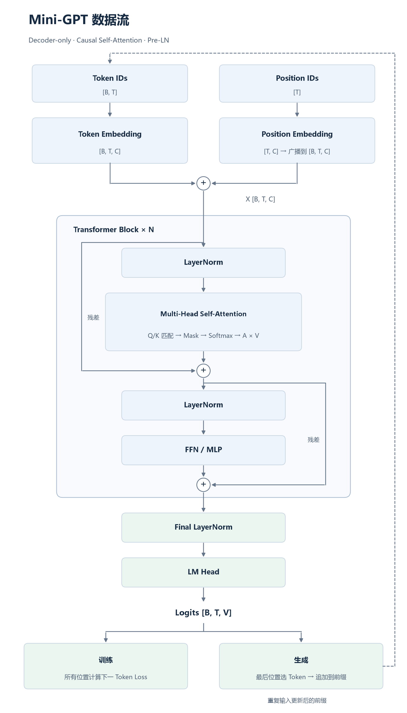

# Transformer 学习笔记：从 Self-Attention 到 Mini-GPT

[返回项目首页](../README.md) · [配套实验](01_Attention_Fundamentals.ipynb)

> 基于《Transformer 从零入门》Google Colab Notebook 和本次学习中的连续问答整理。聚焦 Transformer 机制及设计动机，不整理 PyTorch API、张量操作语法和 Colab 设置。
>
> **学习主线**：Token ID → Token / Position Embedding → Q/K/V → Scaled Dot-Product Attention → Causal Mask → Multi-Head Attention → Transformer Block → Next-Token Prediction → Autoregressive Generation。

## 1. 为什么需要 Token Embedding？

**问：Token Embedding 是不是把输出转换成 ID？**

不是，方向恰好相反：**Token Embedding 将离散的 Token ID 映射成连续特征向量**；生成端则把隐藏特征映射为词表上各个 Token 的预测分数（logits），再选择 Token ID。

设词表大小为 $V$ 、隐藏维度为 $C$ ，Token Embedding 是一张可训练的表 $E\in\mathbb R^{V\times C}$ 。输入 `[5, 7, 8, 1]` 后，查出四个向量，形成 $4\times C$ 的特征矩阵（如果保留 Batch 维，则是 $[1,4,C]$ ）。

**问：Token ID 没有信息量，只是标记，特征在 Embedding 之后才显现，对吗？**

基本正确。ID 是离散编号，数值大小、编号间距离没有固有的语义意义。Embedding 为每个编号提供可训练表示；训练后，这些向量可能学到有助于任务的特征关联。**随机初始化的 Embedding 并不天然带有语义**，而且真正的上下文信息通常还要经过 Transformer Block 才能形成。

**区分输入与输出：**

$$
\underbrace{[B,T]}_{\text{Token IDs}}
\xrightarrow{\text{Token Embedding}}
\underbrace{[B,T,C]}_{\text{隐藏特征}}
\xrightarrow{\text{Transformer}}
[B,T,C]
\xrightarrow{\text{LM Head}}
\underbrace{[B,T,V]}_{\text{Logits}}
$$

从 logits 选择 Token ID 时，可以用最高分选择（greedy decoding）或按概率抽样（sampling）。

## 2. 为什么需要 Position Encoding？

**问：Token Embedding 已经得到向量，为什么还要加位置编码？**

不包含位置机制的普通 Self-Attention 本身不知道 Token 的绝对先后顺序：同步重排输入 Token，输出也会对应重排（Permutation Equivariance）。仅知道“是什么”，还需要知道“在哪里”。

教学 Mini-GPT 使用**可学习的绝对位置嵌入（Learnable Positional Embedding）**：每个位置 $t$ 对应可训练向量 $p_t$ ，输入为

$$
h_t=e_{x_t}+p_t.
$$

**问：每个 Batch 是否加相同的位置编码？**

是。若各样本都从位置 0 开始，同一位置 $t$ 共享相同的 $p_t$ ，但不同样本的 Token Embedding 可能不同，因此最终特征不一定相同。

**问：原始 Transformer 不是使用 sin/cos 吗？**

是的。2017 年原始 Transformer 使用固定的 **Sinusoidal Positional Encoding**，不是这里的可学习查表方式：

$$
PE(pos,2i)=\sin\left(\frac{pos}{10000^{2i/C}}\right),\qquad
PE(pos,2i+1)=\cos\left(\frac{pos}{10000^{2i/C}}\right).
$$

偶数通道与奇数通道形成不同频率的 sin/cos 配对；它不增加位置表的可训练参数，并具有与相对位移相关的结构。可学习位置嵌入则由训练数据决定各个位置向量。两者目标相同，但机制不同。现代模型也广泛使用 RoPE 等方式：将位置信息作用于 Q/K，而不是简单加在 Token 特征上。

## 3. Self-Attention 为什么要使用 Q、K、V？

**问：为什么不是直接用输入 $X$ 计算 $XX^\top$ ？为什么一定要 Q/K/V 三个？**

直接对 $X$ 计算相似度并用 $X$ 聚合，数学上也能构成一种 Attention。但使用三个独立的可训练投影，能够将**匹配规则**与**被传递的内容**分开：

$$
Q=XW_Q,\qquad K=XW_K,\qquad V=XW_V.
$$

此处是论文中的行向量右乘记法。三者都来自同一个 $X$ ，并不是三份不同原始数据。

- **Query (Q)**：当前 Token 希望匹配什么特征；
- **Key (K)**：其他 Token 提供什么特征供匹配；
- **Value (V)**：其他 Token 真正传递什么信息。

**问：Q 和 K 为什么还要区分？**

如果二者使用独立投影，则一般有 $q_i k_j^\top\neq q_j k_i^\top$ ：A 关注 B，并不要求 B 同等关注 A。单纯的 $XX^\top$ 在 Softmax 之前是对称的，表达匹配关系的自由度更小。

**问：已经算出 $QK^\top$ ，为什么还要乘 V？**

$QK^\top$ 只得到了**从哪里获取信息的分数**；Softmax 将分数转为权重；只有再乘 V，才形成**具体获取到的信息**：

$$
A=\mathrm{softmax}\left(\frac{QK^\top}{\sqrt{d_k}}\right),\qquad Y=AV.
$$

对于第 $i$ 个 Query：

$$
y_i=\sum_{j=1}^{T}a_{ij}v_j.
$$

例如 $a_{1,:}=[0.1,0.2,0.4,0.2,0.1]$ ，则

$$
y_1=0.1v_1+0.2v_2+0.4v_3+0.2v_4+0.1v_5.
$$

每个 $a_{ij}$ 是标量，每个 $v_j$ 是向量，结果是对 Value 向量按 Token 维度做加权求和。**Q/K 负责信息选择，V 负责内容聚合。**

## 4. Attention 为什么产生 $[T,T]$ ，又为什么按 Key 做 Softmax？

对于 Self-Attention，如果一个样本有 $T$ 个 Token， $Q,K\in\mathbb R^{T\times d_k}$ ，则：

$$
QK^\top:\quad [T,d_k]\thinspace [d_k,T]\to[T,T].
$$

行索引 $i$ 是 Query 位置，列索引 $j$ 是 Key 位置： $s_{ij}=q_i k_j^\top/\sqrt{d_k}$ 。一个 Query 要对**所有 Key**分配注意力，因此对每行归一化：

$$
a_{ij}=\frac{e^{s_{ij}}}{\sum_{k=1}^{T}e^{s_{ik}}},\qquad\sum_j a_{ij}=1.
$$

**问：为什么不是按 Query 归一化？** 因为标准 Attention 想回答“第 $i$ 个 Query 应该从哪些 Key 获取信息”，不是“某个 Key 应该被多少 Query 分配关注度”。

**问：随机初始化时，某两个 Token 之间权重大，就能解释为学到了语义关联吗？** 不能。Attention Weight 是由当前输入和 Q/K 参数计算出的动态量。未训练时只是随机投影下的匹配结果；即使训练后，也不能单凭权重大小断言模型理解了某一语义关系。

## 5. Q/K/V 的 Bias 为什么有时省略？

**问：为什么投影层有时不设置 Bias？它们真的没用吗？**

不是所有 Bias 都没用。对于普通点积 Attention，**共享的 Key Bias** 有一个明确的冗余性质。设

$$
k_j=k_j^{(0)}+b_K,
$$

那么对于固定 Query $i$ ：

$$
q_i^\top k_j=q_i^\top k_j^{(0)}+q_i^\top b_K.
$$

第二项对同一行的所有 Key 都是同一个常数。而 Softmax 满足：

$$
\mathrm{softmax}(z+c\mathbf1)=\mathrm{softmax}(z),
$$

因此 Key Bias 的这一共同平移会在按行 Softmax 中抵消。

相比之下：

- **Query Bias** 会产生随 Key 改变的匹配项，一般影响注意力分布；
- **Value Bias** 不改变 QK 得到的权重，但直接影响加权后的输出；在某些含输出投影 Bias 的架构中，其影响可以被后续 Bias 吸收。

**结论：** `bias=False` 是架构与实现选择，不是 Q/K/V 的数学必要条件。

## 6. 为什么需要 Causal Attention / Causal Mask？

**问：Mini-GPT 为什么必须使用 Causal Attention？**

因为它执行 **Next-Token Prediction（下一 Token 预测）**：位置 $t$ 必须根据 $x_{\le t}$ 预测 $x_{t+1}$ ，不能在训练时读到输入序列中后面的位置，避免目标泄漏。

例如输入 `[3,4,5,6]`，每个位置分别预测 `[4,5,6,7]`。若第一个位置可以看见第二个输入 Token `4`，模型可能直接“偷看”答案，而不学习从已有前缀预测未来。

Causal Mask 使每个 Query 仅能关注**自身和之前**的 Key。它是下三角可见性约束：

$$
M_{ij}=\begin{cases}
0,&j\le i,\\
-\infty,&j>i.
\end{cases}
$$

计算为：

$$
A=\mathrm{softmax}\left(\frac{QK^\top}{\sqrt{d_k}}+M\right).
$$

被掩码的位置在 Softmax 后权重为 0。因此因果顺序应是：**Scores → Mask → Softmax → Value Aggregation**。

**问：为什么不直接每次只输入前面的 Token 训练？**

因为利用 Mask 可以在一次前向传播中**并行计算整个序列所有位置的训练预测**，同时保证每个位置的信息合法性。相较逐个前缀分别前向，效率高得多。

**注意：** Causal Attention 不是所有 Transformer 的要求。原始 Encoder 与 ViT 通常是双向 Self-Attention；GPT 的自回归语言建模需要因果约束。

## 7. Multi-Head Attention 为什么要分头？

**问：把 Channel 分成多个 Head，是不是把 Token 也分开处理了？**

不是。**每个 Head 都能看到全部 Token**，只是对 Token 使用自己的一组 Q/K/V 投影特征。

例： $C=32$ 、 $H=4$ ，每个 Head 的维度 $d_h=8$ 。每个 Head 独立计算：

$$
head_h=\mathrm{softmax}\left(\frac{Q_hK_h^\top}{\sqrt{8}}+M\right)V_h.
$$

然后拼接各头输出并作输出投影：

$$
Y=\mathrm{Concat}(head_1,\ldots,head_H)W_O.
$$

这种设计允许不同 Head 学习不同的匹配规则和聚合方式，而不强制所有关系使用同一张 Attention 权重图。并非每个 Head 都一定会学到清晰可解释、互不重复的语义功能。

**问：为什么缩放时除以 $\sqrt{8}$ 而不是 $\sqrt{32}$ ？**

因为每个 Head 的 Q/K 点积发生在 $d_h=8$ 的特征空间。缩放因子应对应实际点积维度 $\sqrt{d_h}$ ，以减轻高维点积分数过大导致 Softmax 过于尖锐的问题。

### 7.1 既然 Channel 被拆分了，Head 之间是不是无法计算全局关联？

**我的疑问：** 多头把 32 个 Channel 切成 4 组，每组只有 8 维。如此一来，不同 Head 的 Channel 不能彼此计算 Attention，是否损失了全局特征关联？

**答：要区分“投影之前的全局信息”和“投影之后的独立计算”。**

1. **先投影，再分头。** 对完整的输入 $X\in\mathbb R^{T\times32}$ ，第 $h$ 个 Head 通过其自己的投影矩阵得到 $Q_h=XW_Q^{(h)}$ 、 $K_h=XW_K^{(h)}$ 、 $V_h=XW_V^{(h)}$ ，其中 $W_Q^{(h)},W_K^{(h)},W_V^{(h)}\in\mathbb R^{32\times8}$ 。因此，每个 Head 的 8 维特征都**可以由原始全部 32 个 Channel 线性组合而来**，不是只截取原始输入中的 8 个 Channel。
2. **计算 Attention 时，Head 之间确实独立。** 第一个 Head 的 $Q_1$ 不直接和第二个 Head 的 $K_2$ 做点积。每个 Head 独立产生 $[T,T]$ 的权重矩阵；但**所有 Head 都覆盖全部 $T$ 个 Token**，不是只关注一部分 Token。
3. **计算完成后再融合。** $\mathrm{Concat}(head_1,\ldots,head_H)$ 经 $W_O\in\mathbb R^{32\times32}$ 投影，各 Head 输出重新混合；后续层又可以在混合后的特征上重新构建 Q/K/V。

因此更准确的结构是：

$$
\boxed{\text{全部输入 Channel 投影}\ \longrightarrow\ \text{各 Head 独立的低维 Attention}\ \longrightarrow\ \text{输出混合}}
$$

**需要保留的限制：** 一个 Head 的 Q/K 匹配只在其 8 维空间内完成；不存在同一层里所有 Head 之间任意的交叉 Q/K 点积。全维输入投影和输出混合并不意味着它与单个 32 维 Attention 的计算等价。

### 7.2 为什么多头能学习多种关联？仅仅因为初始化不同吗？

**我的疑问：** 不同 Head 之所以会关注不同 Token，是不是因为一开始初始化的参数不同？

**答：随机初始化有助于打破对称性，但根本原因是不同 Head 拥有相互独立、可以分别学习的 Q/K/V 参数，以及各自的 Attention 权重分布。**

对同一个 Query，单头只产生一套 $a_{ij}$ ，并用这套 Token 权重聚合它负责的所有 Value 通道：

$$
o_i=\sum_j a_{ij}v_j.
$$

而多头可以让不同 Head 对同一个 Query 产生不同权重：

$$
o_i^{(1)}=\sum_j a_{ij}^{(1)}v_j^{(1)},\qquad
  o_i^{(2)}=\sum_j a_{ij}^{(2)}v_j^{(2)}.
$$

例如，第一个 Head 可以偏向前一个 Token，第二个 Head 可以偏向更早的 Token；这些只是**可能学到的模式**，不是预先写死的规则。

具体逻辑是：

- **随机初始化：** 不同 Head 的权重起点通常不同，但此时的 Attention 差异不代表已学到语义。
- **参数独立：** 各 Head 有不同的 Q/K/V 投影，因此具备学习不同匹配关系的自由度。代码即便使用一个 `Linear(d_model, 3*d_model)`，切分出的各 Head 仍对应这个大权重矩阵中的不同参数子块。
- **任务驱动训练：** Loss 经过反向传播，更新各 Head 参数；不同的匹配与聚合模式可能有助于降低同一个任务损失。
- **不保证分工：** 不同 Head 可能学到相似甚至冗余的关联，不能断言头数越多越好，也不能仅凭可视化就认定其语义功能。

### 7.3 多头与单头的真正差别

**问：如果最后都要融合成 $d_{model}$ 维，多头到底多出了什么能力？**

重要区别不是“输出 Channel 更多”，而是**同一层中能并行使用多套不同的 Token 注意力权重**。单头即使采用完整的 $d_{model}=32$ 维 Q/K，仍只有一张 $[T,T]$ 的注意力图；四头可以产生四张不同的图，分别聚合不同的 Value 子空间，再经输出投影融合。

但在固定 $d_{model}$ 下，Head 越多，每个 Head 的 $d_h=d_{model}/H$ 越小，因此存在**单头特征维度与注意力模式数量之间的权衡**。不能简单认为多头必然比单头好，或各头必然具有独立语义。

**阶段性结论：** 多头机制的目的，是为不同的 *Token 关联/信息聚合模式* 提供独立可学习的通路，而不是简单把输入的原始 Channel 隔离成互不通信的局部区域。

## 8. Attention Dropout 是原始 Transformer 就有的吗？

**问：为什么在 Attention Weight 和 V 相乘前加入 Dropout？**

训练时可以对 Softmax 后的部分注意力权重随机置零，减少模型过度依赖特定注意力连接，帮助正则化。2017 年原始 Transformer 的训练配置确实包括 Attention Dropout 以及其他位置的 Dropout。

$$
\widetilde A=\mathrm{Dropout}(A),\qquad Y=\widetilde A V.
$$

训练时保留的权重通常按 $1/(1-p)$ 缩放，因而 Dropout 后一行的权重和**不一定等于 1**；推理模式下关闭 Dropout。Dropout 是**训练机制**，不是 Attention 数学定义的必要部分。

## 9. Transformer Block：原始架构与 Mini-GPT 为什么不同？

**问：学习代码中的 TransformerBlock 好像不是原始 Transformer？**

对。教学模型使用更接近 GPT 的 **Decoder-only、Causal Self-Attention、Pre-LN** 结构：

$$
x_1=x+\mathrm{MHA}(\mathrm{LN}(x)),
$$

$$
y=x_1+\mathrm{MLP}(\mathrm{LN}(x_1)).
$$

而原始《Attention Is All You Need》（2017）使用 **Encoder–Decoder** 架构；其子层为 **Post-LN**，即残差相加后再 LayerNorm：

$$
x_1=\mathrm{LN}(x+\mathrm{MHA}(x)),
$$

$$
y=\mathrm{LN}(x_1+\mathrm{FFN}(x_1)).
$$

两者对比：

| 特性 | 2017 原始 Transformer | 这份 Mini-GPT |
|---|---|---|
| 整体结构 | Encoder–Decoder | Decoder-only |
| 归一化位置 | Post-LN | Pre-LN |
| Decoder 注意力 | Masked Self-Attention + Cross-Attention | Causal Self-Attention |
| FFN 激活函数 | ReLU | GELU |
| 位置表示 | 固定 Sin/Cos | 可学习绝对位置 Embedding |

**问：LayerNorm 需要学到什么程度？**

主要理解其对**每个 Token 的特征维度**分别计算均值和方差，并使用可学习的缩放 $\gamma$ 和平移 $\beta$ ：

$$
\mathrm{LN}(x_i)=\gamma\odot\frac{x_i-\mu_i}{\sqrt{\sigma_i^2+\epsilon}}+\beta.
$$

它帮助稳定特征尺度与训练，不负责 Token 间信息交互。**Residual Connection（残差连接）** 让输入直接绕过子层后与子层输出相加，有利于优化与信息传递。**FFN/MLP** 对每个 Token 的特征独立进行非线性变换，不负责跨 Token 交互。实际位置间的信息传递由 Attention 完成。

## 10. vocab_size、context_length 和 T 究竟有什么区别？

**问：Mini-GPT 的三个参数是否都是序列长度？**

不是：

- $`V=\texttt{vocab\_size}`$ ：有多少种不同 Token，可用 ID 范围；决定 Token Embedding 的词表行数和 LM Head 的类别数。
- $`L=\texttt{context\_length}`$ ：这个模型配置下一次最多处理多少个 Token；在教学实现中，也决定可学习位置表的大小。
- $T$ ：当前这一次输入序列的实际长度，要求 $T\le L$ 。

例如 $V=10,L=16,T=8,B=2,C=32$ 时，模型接受 2 条每条 8 个 Token 的输入，内部特征为 $[2,8,32]$ ，最后输出 logits 为 $[2,8,10]$ 。 $V$ 不必与 $T$ 或 $L$ 存在大小关系。

## 11. 为什么每个位置都预测下一个 Token？

**问：模型一次输出整个序列的 logits，其他位置的预测有什么用？**

在训练阶段，它们全部提供监督：

| 当前位置可见前缀 | 训练目标 |
|---|---|
| `[3]` | `4` |
| `[3,4]` | `5` |
| `[3,4,5]` | `6` |
| `[3,4,5,6]` | `7` |

一次带因果掩码的 Forward 同时完成这四次预测，并对所有位置的目标进行 **Cross-Entropy Loss**。在这个过程中， $[B,T,V]$ 表示每个样本每个位置都对 $V$ 种 Token 输出一组 logits。每个位置产生一个分类损失，训练时通常在所有有效位置求平均：

$$
\mathcal L=-\frac1{BT}\sum_{b=1}^{B}\sum_{t=1}^{T}
\log P_\theta(x_{b,t+1}\mid x_{b,\le t}).
$$

这里假定所有位置都有效；真实任务含 Padding 时，通常需要屏蔽无效位置。

**问：推理阶段前面位置的预测是不是应该与输入匹配？**

如果输入服从模型学得很好的确定性规律，**前面位置的预测应尽量匹配其后一个输入 Token，而不是匹配当前位置**。例如输入 `[3,4,5,6]`，理想预测是 `[4,5,6,7]`。但一般语言生成具有不确定性，模型预测概率最高的词不一定等于真实出现的下一个词。

## 12. 自回归生成为什么只使用最后一个位置？

**问：生成的每一步具体发生什么？**

以 Prompt `[3]` 为例：

1. 输入已有前缀 `[3]`，模型输出对下一个 Token 的概率分布，选择 `4`；
2. 将 `4` 追加成 `[3,4]`，重新基于当前上下文预测 `5`；
3. 继续追加、再预测，形成 `[3,4,5,…]`。

**问：既然 Forward 输出所有位置，为什么生成只取最后位置？**

因为前面位置已经对应序列内部的下一 Token 预测，只有最后一个位置对应**当前前缀之后尚不存在的 Token**。因此生成时取最后一个位置的 logits，再进行 greedy decoding 或 sampling。

$$
P(x_{1:n})=\prod_{t=1}^{n}P(x_t\mid x_{\lt t})
$$

这是**Autoregressive Generation（自回归生成）** 的基本思想。

**问：为什么每步都重新传入整个上下文？**

因为最终位置的预测通常需要整个已有历史。教学版 Mini-GPT 每步重新计算上下文的注意力，实际大语言模型通常借助 **KV Cache** 复用历史 Key/Value，减少重复计算。模型也有 Context Window 长度限制：超长时需要截断或使用专门的扩展机制。

**训练与生成区别：**

- **训练**：给定真实序列，用 Causal Mask 并行计算所有位置的下一 Token Loss（Teacher Forcing）。
- **生成**：模型输出逐个 Token 反馈给自己；后续 Token 依赖先前已生成结果，因而一般逐步解码。

## 13. 这份 Mini-GPT 实验究竟验证了什么？

**问：数字加一任务根本不需要 Attention 吧？**

**完全正确。** 该任务的规则是

$$
x_{t+1}=(x_t+1)\bmod10.
$$

下一个数字只依赖当前数字，连普通逐 Token 映射都可以完成：

$$
P(x_{t+1}\mid x_{\le t})=P(x_{t+1}\mid x_t).
$$

所以这里加入 Attention **不是因为任务需要跨 Token 信息**，而是为了把完整的 Transformer 组件串起来，验证前向、因果掩码、训练、Loss 和自回归生成。**Loss 下降不能作为 Attention 有价值的证据。**

下一步更适合做**真正依赖上下文的任务**：例如要求当前位置预测前面第 $k$ 个位置的 Token，或根据序列开头的规则标记决定后续输出。应对比无 Attention 的逐 Token 基线与 Transformer，并检查模型是否真的利用历史信息，以及不同 Head 的注意力模式。

## 14. 最终概念图与复习要点

[绘图源码](assets/minigpt_flow.py)

**务必能独立回答的 10 个问题：**

1. 为什么整数 Token ID 需要 Embedding，而不能直接当成语义特征？
2. 为什么 Token Embedding 之外还需要 Position Encoding？
3. Q/K/V 的区别是什么，为什么 $QK^\top$ 还要乘 V？
4. 为什么一行 Attention Weight 对应一个 Query 对所有 Key 的权重？
5. 为什么 Multi-Head 不等于把 Token 分组？
6. 为什么拆分后的 Head 仍可利用全部输入 Channel，各 Head 输出又如何融合？
7. 为什么不同 Head *可以* 学到不同关联，但随机初始化并不保证出现有效分工？
8. Causal Mask 为什么能防止训练阶段的信息泄漏？
9. Pre-LN Mini-GPT Block 与 2017 Encoder–Decoder Transformer 的区别是什么？
10. 为什么训练并行预测所有位置，而生成逐个使用最后位置？

---

*笔记范围：当前入门 Notebook 与学习问答。后续可扩展 Cross-Attention、完整 Encoder–Decoder、RoPE、KV Cache，以及适用于长距离依赖的实验。*

---

[返回项目首页](../README.md) · [配套实验](01_Attention_Fundamentals.ipynb) · [下一章：02 · Encoder-Decoder Transformer](../02_Encoder_Decoder_Transformer/02_Encoder_Decoder_Transformer.ipynb)
