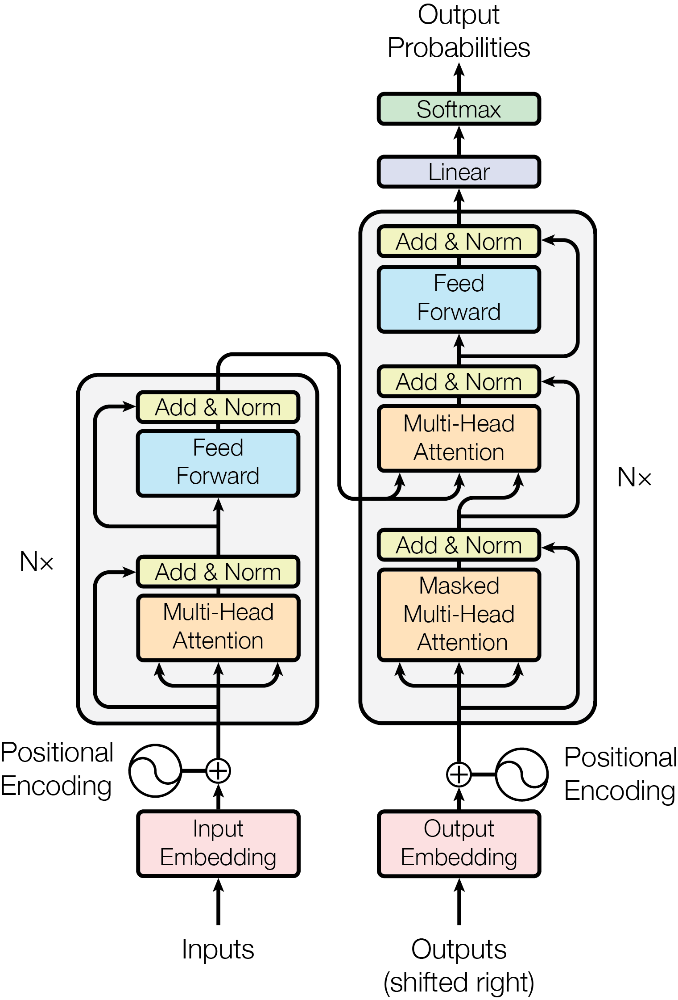

# 02_Encoder_Decoder_Transformer

[返回项目首页](../README.md) · [实验 Notebook](02_Encoder_Decoder_Transformer.ipynb) · [上一章笔记](../01_Attention_Fundamentals/01_Attention_Fundamentals.md)

## Overview

本章学习原始 Transformer（Encoder–Decoder Transformer）结构。

符号约定： $B$ 为批量大小， $S$ 为源序列长度， $T$ 为目标序列长度， $C=d_{\mathrm{model}}$ 为隐藏维度， $H$ 为 Attention 头数， $D=C/H$ 为每个 Head 的维度。

第一阶段已经学习：

-   Self-Attention
-   Multi-Head Attention
-   Causal Mask
-   MiniGPT

本阶段进一步理解：

-   Encoder 如何编码输入序列
-   Decoder 如何生成输出序列
-   Cross-Attention 如何连接 Encoder 和 Decoder
-   Teacher Forcing 为什么需要目标序列右移

核心思想：

$$
Encoder:X_{src}\rightarrow Memory
$$

$$
Decoder:(Y_{history},Memory)\rightarrow Output
$$

------------------------------------------------------------------------

<a id="original-transformer-architecture"></a>

# 1. Original Transformer Architecture

原始 Transformer 由 Encoder 和 Decoder 两部分组成。

下图为原论文 Figure 1，直接提取自论文 PDF 内嵌图片，保留原始标签与连线。

<p align="center">
  
</p>

图源：Vaswani et al., *[Attention Is All You Need](https://arxiv.org/abs/1706.03762)*（2017），Figure 1；提取版本为 [arXiv v7 PDF，第 3 页](https://arxiv.org/pdf/1706.03762v7#page=3)。论文首页说明 Google 允许在注明来源的新闻或学术作品中转载图表；该第三方图片不适用本仓库的 MIT License。

图中的 $N\times$ 表示堆叠多个层；原论文的 Encoder、Decoder 各有 6 层，本章教学代码各使用 1 个 Block。

其中：

-   Encoder 将输入编码为上下文表示；
-   Decoder 根据历史输出和 Encoder 信息生成结果。

------------------------------------------------------------------------

# 2. Encoder

## 2.1 Encoder 的作用

Encoder 将输入 Token 转换为包含上下文信息的表示。

输入：

$$
X_{src}\in\mathbb{R}^{B\times S\times C}
$$

输出：

$$
Memory\in\mathbb{R}^{B\times S\times C}
$$

------------------------------------------------------------------------

## 2.2 Encoder Block

Encoder Block 包含：

1.  Self-Attention
2.  Feed Forward Network
3.  Residual Connection
4.  LayerNorm

公式：

$$
X_1=
\mathrm{LayerNorm}
(X+\mathrm{MHA}(X))
$$

$$
X_2=
\mathrm{LayerNorm}
(X_1+\mathrm{FFN}(X_1))
$$

Encoder 使用普通 Self-Attention：

$$
Q=XW_Q
$$

$$
K=XW_K
$$

$$
V=XW_V
$$

因为 Encoder 输入完整可见，所以：

-   不需要 Causal Mask；
-   每个 Token 可以关注所有输入 Token。

------------------------------------------------------------------------

# 3. Decoder

Decoder 比 Encoder 多一个 Cross-Attention。

对应[原论文架构图](#original-transformer-architecture)右侧，每个 Decoder Block 从下到上依次包含：

1. Masked Self-Attention：读取右移后的目标序列前缀。
2. Cross-Attention：以第一子层的输出构造 Query，以 Encoder Memory 构造 Key 和 Value。
3. Feed Forward Network：对每个位置进行非线性特征变换。

每个子层都有 Residual Connection 和 Add & Norm；本章采用原始 Transformer 的 Post-LN 顺序。

------------------------------------------------------------------------

# 4. Cross-Attention

## 4.1 为什么需要 Cross-Attention？

Self-Attention 只能处理：

同一个序列内部的信息交换。

但是 Encoder-Decoder 中：

-   Encoder 处理输入序列；
-   Decoder 生成输出序列。

Decoder 需要读取 Encoder 提供的信息。

因此引入 Cross-Attention。

------------------------------------------------------------------------

## 4.2 Cross-Attention 与 Self-Attention 区别

Self-Attention：

$$
Q=XW_Q
$$

$$
K=XW_K
$$

$$
V=XW_V
$$

Cross-Attention：

$$
Q=X_{dec}W_Q
$$

$$
K=X_{enc}W_K
$$

$$
V=X_{enc}W_V
$$

核心区别：

> Attention 公式不变，只改变 Q、K、V 的来源。

------------------------------------------------------------------------

## 4.3 Cross-Attention 计算

统一公式：

$$
Attention(Q,K,V)=
\mathrm{softmax}
\left(
\frac{QK^T}{\sqrt{d_k}}
\right)V
$$

先考虑单个 Head，省略 Head 维； $d_k$ 为 Query/Key 维度， $d_v$ 为 Value 维度：

$$
Q\in\mathbb{R}^{B\times T\times d_k}
$$

$$
K\in\mathbb{R}^{B\times S\times d_k},
\qquad V\in\mathbb{R}^{B\times S\times d_v}
$$

则：

$$
QK^T
\in
\mathbb{R}^{B\times T\times S}
$$

其中转置只交换最后两个维度，Softmax 沿 $S$ 维计算。多头实现中，每个 Head 使用 $d_k=d_v=D=C/H$，因此缩放因子是 $\sqrt{D}$。

含义：

-   每个 Decoder Token；
-   与所有 Encoder Token；
-   计算关联程度。

------------------------------------------------------------------------

# 5. Multi-Head Cross-Attention 维度变化

输入：

Decoder:

$$
[B,T,C]
$$

Encoder:

$$
[B,S,C]
$$

拆分 Head：

$$
[B,T,C]
\rightarrow
[B,H,T,D]
$$

其中：

$$
C=H\times D
$$

Attention Score：

$$
[B,H,T,D]
@
[B,H,D,S]
$$

得到：

$$
[B,H,T,S]
$$

再乘 Value：

$$
[B,H,T,S]
@
[B,H,S,D]
$$

得到：

$$
[B,H,T,D]
$$

最后合并 Head：

$$
[B,T,H,D]
\rightarrow
[B,T,C]
$$

------------------------------------------------------------------------

# 6. 为什么 Causal Attention 通常用于 Decoder Self-Attention？

问题：

> Mask Attention 必须是 Self-Attention 吗？

答案：

不是。

但是在经典 Transformer 中：

## Decoder Self-Attention

需要 Causal Mask。

原因：

预测：

$$
y_t
$$

时只能看到：

$$
y_1,...,y_{t-1}
$$

不能看到未来 Token。

------------------------------------------------------------------------

## Cross-Attention

通常不使用 Causal Mask。

原因：

Encoder 输入已经完整存在。

例如机器翻译：

Encoder:

    I love robot

Decoder:

    我 喜欢

Decoder 可以读取完整英文输入。

------------------------------------------------------------------------

# 7. 为什么代码中 assert T == S？

代码：

``` python
assert T == S
```

原因：

当前实现的 Causal Mask：

$$
M\in\mathbb{R}^{T\times S}
$$

使用：

``` python
tril()
```

默认假设：

Query 和 Key 位置一一对应。

适用于：

Decoder Self-Attention：

$$
T=S
$$

这个断言只在代码的 `causal=True` 分支执行，限定当前掩码用于 Query/Key 位置对齐的 Decoder Self-Attention。

Cross-Attention 的 $T$ 与 $S$ 可以相等，也可以不同；它由 Q 与 K/V 的来源定义，而不是由长度是否相等定义。本章 Cross-Attention 使用 `causal=False`，不会进入上述断言。即使两端长度相等，也不能直接认为源、目标位置在时间上对齐；是否需要 Mask 取决于任务的信息可见性。

------------------------------------------------------------------------

# 8. Sinusoidal Position Encoding

## 8.1 为什么需要位置编码？

Self-Attention 本身不知道 Token 顺序。

因此：

$$
Input=
TokenEmbedding+PositionEncoding
$$

------------------------------------------------------------------------

## 8.2 Sin/Cos 公式

$$
PE(pos,2i)=
\sin
\left(
\frac{pos}{10000^{2i/d_{model}}}
\right)
$$

$$
PE(pos,2i+1)=
\cos
\left(
\frac{pos}{10000^{2i/d_{model}}}
\right)
$$

------------------------------------------------------------------------

## 8.3 为什么使用 sin/cos？

原因：

### 1. 连续变化

相邻位置具有连续表示。

### 2. 多尺度

不同 Channel 使用不同频率：

-   高频：随位置变化较快，提供较细的变化尺度；
-   低频：随位置变化较慢，提供较粗的变化尺度。

这些频率提供多尺度位置特征，并不保证模型自动学到相应的长短距离依赖。

### 3. 相对位置

三角函数具有：

$$
\sin(a+b)
$$

$$
\cos(a+b)
$$

的加法公式：对于固定偏移量，同一频率的 Sin/Cos 对可以通过线性变换表示偏移后的位置。这提供了表达相对位置的结构，但不保证训练后的模型具有任意长度外推能力。

------------------------------------------------------------------------

## 8.4 为什么是 10000？

10000 控制不同 Channel 的频率范围。

对于偶数维度 $d_{\mathrm{model}}$，实际角频率为：

$$
\omega_i=10000^{-2i/d_{\mathrm{model}}},
\qquad i=0,\ldots,\frac{d_{\mathrm{model}}}{2}-1
$$

最大角频率为 $1$，最小为 $10000^{-(d_{\mathrm{model}}-2)/d_{\mathrm{model}}}$；后者随模型宽度增大接近 $1/10000$，并非有限维度下恰好等于它。

这是经验参数，用于覆盖不同长度序列。

------------------------------------------------------------------------

# 9. LM Head

## 9.1 Transformer 输出是什么？

Transformer 输出：

$$
Hidden
$$

它不是 Token ID。

它是：

上下文相关的连续特征。

------------------------------------------------------------------------

## 9.2 为什么需要 LM Head？

需要将：

$$
Hidden
$$

映射到：

$$
Vocabulary
$$

代码：

``` python
logits=self.lm_head(hidden)
```

数学：

$$
Logits=HiddenW_{out}+b_{out}
$$

这里采用行向量右乘的数学记法， $W_{out}\in\mathbb{R}^{C\times V}$；PyTorch `nn.Linear` 存储的权重形状为 `[V,C]`，实际计算 `hidden @ weight.T + bias`。当前代码保留了 Bias。

维度：

$$
[B,T,C]
\rightarrow
[B,T,V]
$$

其中：

-   C：隐藏维度；
-   V：词表大小。

------------------------------------------------------------------------

# 10. Teacher Forcing

## 10.1 为什么 Decoder 输入不能直接使用完整 target？

错误：

输入：

$$
[A,B,C,D]
$$

预测：

$$
[A,B,C,D]
$$

问题：

模型已经看到答案。

称为：

Target Leakage。

------------------------------------------------------------------------

## 10.2 正确训练方式

Decoder 输入：

$$
[BOS,A,B,C]
$$

目标：

$$
[A,B,C,D]
$$

即：

$$
DecoderInput=Target\ shifted\ right
$$

右移必须与 Causal Mask 配合：右移避免同一位置直接看到待预测 Token，Mask 则阻止读取右侧位置中已经包含的答案。

------------------------------------------------------------------------

# 11. BOS 与 EOS

BOS：

Beginning Of Sequence

作用：

告诉 Decoder 开始生成。

EOS：

End Of Sequence

作用：

告诉模型停止生成。

二者作用不同。

Shift 的原因不是 EOS。

而是：

> 模拟真实自回归生成过程，避免提前看到答案。

------------------------------------------------------------------------

# 12. Transformer 与 VLA 的联系

Transformer 本身主要负责：

$$
Input\ Tokens
\rightarrow
Contextual\ Representation
$$

也就是：

学习 Token 之间关系和上下文表示。

具体输出由 Head 决定。

语言模型：

$$
Hidden
\rightarrow
Vocabulary
$$

机器人模型：

$$
Hidden
\rightarrow
Action
$$

因此：

LM Head 与 VLA 中的 Action Head / Action Expert 在思想上类似：

$$
Transformer
\rightarrow
Task\ Specific\ Head
$$

这种联系仅指“将表征用于任务输出”。LM Head 通常一次线性映射得到词表 logits；第四章的 DDPM / Flow Matching Policy 则需要条件网络与多步采样，不能把 Action Head / Action Expert 一概等同于线性层。视觉、语言与动作的端到端连接仍是本项目的 Future Topics。

------------------------------------------------------------------------

# 本章总结

1.  Encoder 负责理解输入序列。

2.  Decoder 负责根据历史输出生成未来。

3.  Cross-Attention 是 Encoder 和 Decoder 信息交换的桥梁。

4.  Transformer 输出隐藏表示，任务输出需要额外 Head。

5.  Decoder 训练使用右移目标：

$$
[BOS,y_1,...,y_{n-1}]
\rightarrow
[y_1,...,y_n]
$$

这是一切自回归 Decoder 模型的基础。
