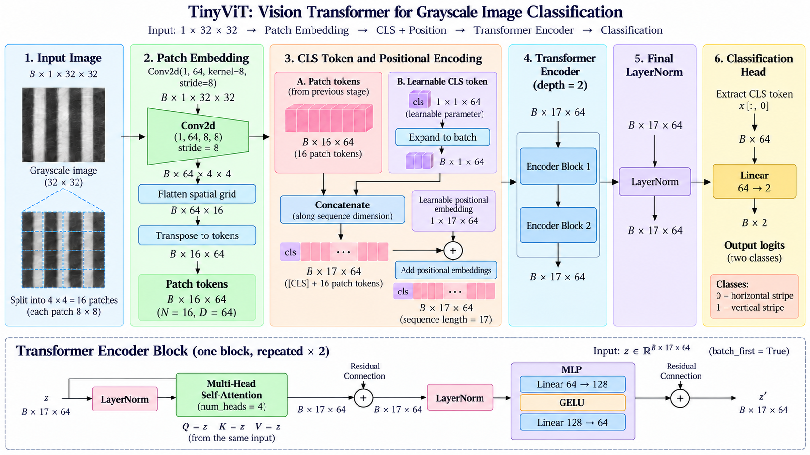
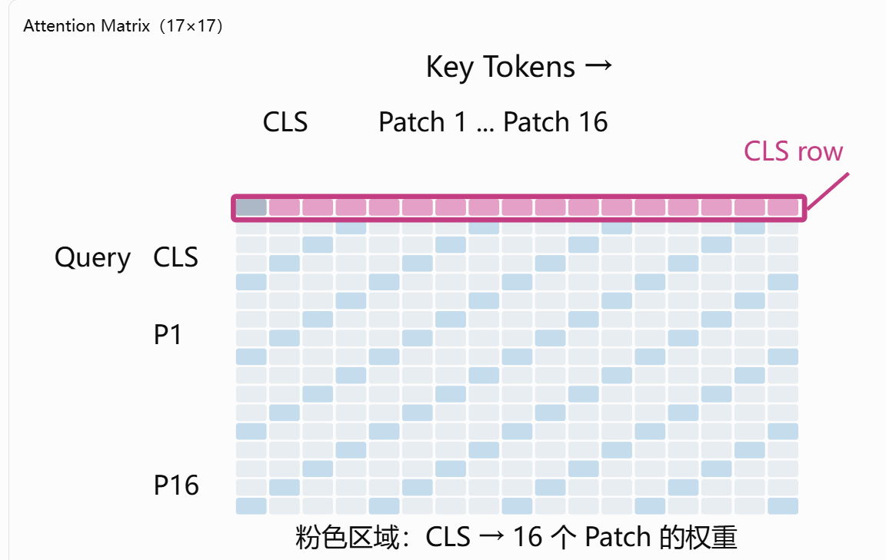
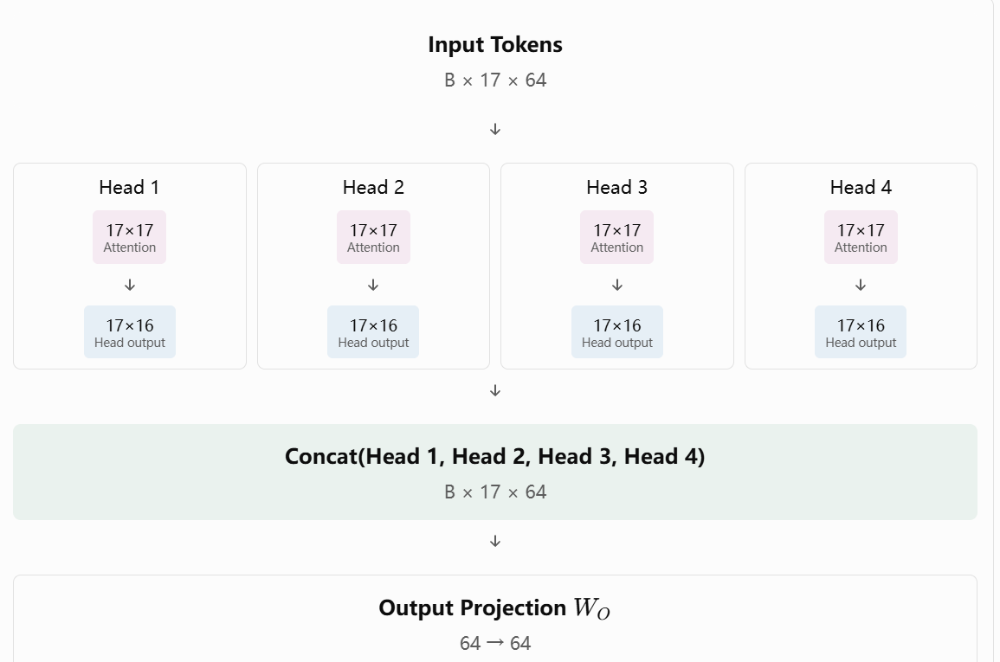
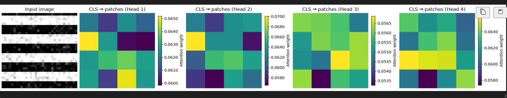

# 03-01 · Vision Transformer (ViT) — From Scratch

[项目首页](../README.md) · [实验 Notebook](01_ViT_From_Scratch.ipynb) · [上一章笔记](../02_Encoder_Decoder_Transformer/02_Encoder_Decoder_Transformer.md) · [下一实验](02_Visual_Token_Projection.ipynb) · [知识库](../KNOWLEDGE_BASE.md#part-ii)

> **Transformer-to-VLA · Chapter 03: Vision Transformers**
>
> 本笔记仅总结本节的 **ViT 模型原理、数学结构及视觉特征形成机制**，不涉及 PyTorch API、环境配置或代码编写。
>
> 核心问题：**如何将二维图像组织成 Token 序列，通过 Transformer 建模图像内部关系，并形成用于下游任务的视觉表征？**

---

## 1. ViT 的整体思想

Transformer 的基本处理对象是 **Token 序列**，而图像通常表示为：

$$
I\in\mathbb{R}^{B\times C\times H\times W}.
$$

这里 $B$ 为批量大小， $C$ 为图像通道数， $H,W$ 为图像高宽；下文用 $D$ 表示 Token 特征维度，用 $H_a$ 表示 Attention Head 数量。

Vision Transformer（ViT）的基本思路是：

1. 将图像划分为不重叠的 **Patches**；
2. 将每个 Patch 投影为固定长度的 **Patch Token**；
3. 加入一个可学习的 **[CLS] Token**，并注入位置编码；
4. 通过多层 **Transformer Encoder** 建模 Token 间关系；
5. 对于图像分类任务，提取最终的 CLS 特征，经分类头输出预测。

**ViT 的核心是视觉特征编码，而不是分类头本身。** 在 VLA 等下游任务中，可以使用经 Transformer 处理的视觉特征，而不必沿用图像分类头。

### 本节 TinyViT 的整体结构

图为结构示意，不是实验输出。图中 Attention 下方的 `Q = K = V` 表示三路输入来自同一份经过 LayerNorm 的 Token 序列；经过各自的可学习投影后，实际的 Q、K、V 通常不同。最终 LayerNorm 与 CLS 选择的等价顺序见第 7 节。

本节采用的简化配置：

| 参数 | 取值 | 含义 |
|---|---:|---|
| 输入图像 | $1\times32\times32$ | 单通道灰度图 |
| Patch size $P$ | 8 | 每个 Patch 的空间边长 |
| Patch 数量 $N$ | 16 | $4\times4$ 个 Patch |
| Token 维度 $D$ | 64 | 每个 Token 的特征长度 |
| CLS Token 数量 | 1 | 位于序列最前端 |
| 序列长度 $L=N+1$ | 17 | CLS + 16 Patch Tokens |
| Encoder depth | 2 | 两个 Transformer Encoder Blocks |
| Attention heads $H_a$ | 4 | 每个 Head 的维度是 16 |
| MLP hidden dimension | 128 | $D\times2$ |
| 分类输出 | 2 | 横向／纵向条纹 |

---

## 2. Patch Embedding：从二维图像到 Token 序列

### 2.1 图像划分

对于 $H\times W$ 图像、Patch 边长 $P$ ，若高宽均可以被 $P$ 整除：

$$
N=\frac{H}{P}\frac{W}{P}.
$$

本节中：

$$
N=\frac{32}{8}\times\frac{32}{8}=4\times4=16.
$$

每个 Patch 包含 $C P^2=1\times8\times8=64$ 个原始像素值。

### 2.2 每个 Patch 的线性投影

对第 $i$ 个展开的 Patch $\mathbf p_i\in\mathbb R^{CP^2}$ ，学习线性投影：

$$
\mathbf z_i=\mathbf p_i E+\mathbf b,\quad
E\in\mathbb R^{CP^2\times D},\quad
\mathbf z_i\in\mathbb R^D.
$$

本节里 $CP^2=64$ ，且 $D=64$ 。**这两个 64 数值相同只是当前配置的巧合**：Patch 的原始像素维度和模型 Token 维度在概念上并不相同。

使用核大小和步长均为 $P$ 的不重叠卷积，可高效实现共享的 Patch 线性投影。

### 2.3 Shape 演化

$$
\underbrace{(B,1,32,32)}_{\text{Input image}}
\rightarrow
\underbrace{(B,64,4,4)}_{\text{Projected feature grid}}
\rightarrow
\underbrace{(B,64,16)}_{\text{Flatten spatial positions}}
\rightarrow
\underbrace{(B,16,64)}_{\text{Patch-token sequence}}.
$$

其中：

- **16** 是 Token 数量／序列长度；
- **64** 是每个 Token 的特征维度；
- 将 $4\times4$ 的空间网格展开成 16 个序列位置，并不意味着把 64 维特征压缩成 16 维。

---

## 3. CLS Token 与位置编码

### 3.1 CLS Token 的作用

分类任务通常在 Patch Tokens 前拼接一个可学习向量：

$$
\mathbf c\in\mathbb R^{1\times1\times D}.
$$

同一个可学习 CLS 初始参数在一个 Batch 内共享：

$$
\mathbf C\in\mathbb R^{B\times1\times D}.
$$

它与图像 Patch Tokens 沿 **序列维** 拼接：

$$
X_{\text{patch}}\in\mathbb R^{B\times16\times64},
\qquad
X_{\text{cat}}=[\mathbf C;X_{\text{patch}}]
\in\mathbb R^{B\times17\times64}.
$$

**关键：是 CLS + Patch Tokens 共同进入 Concatenate，而非 CLS 单独进入 Transformer。**

### 3.2 Position Embedding 的作用

Self-Attention 若没有额外的位置输入，本身不编码 Patch 的二维空间排列。因而在 Token 表征中加入位置向量：

$$
E_{\text{pos}}\in\mathbb R^{1\times17\times64},
$$

$$
\boxed{X_0=[\mathbf C;X_{\text{patch}}]+E_{\text{pos}}}
$$

位置向量与每张图像的对应 Token 相加；对 Batch 中的不同图像复用同一套可学习位置参数。

本节采用 **可学习绝对位置嵌入**。可学习位置向量既可以直接作为参数矩阵维护，也可以通过位置索引查表获得；这些实现方式不改变其核心数学功能。另一类方案是固定正弦位置编码。

### 3.3 为什么 CLS 可以从全零开始，而位置编码采用小随机值？

- **CLS 初始参数为零**：这是合法初始化；它之后仍能接收梯度、被更新，并通过 Attention 聚合当前图像信息。零初始化不是 CLS 的必要条件。
- **位置向量随机初始化**：从训练初期为不同 Token 位置提供不同的标识。乘以较小系数（本节为 $0.02$ ）用于控制初始幅度。
- **位置参数全部置零并非数学上不允许**，但在没有其他位置信息时会弱化模型初期区分 Patch 空间顺序的能力。

由于位置编码包含 CLS 的位置，本节送入第一层 Encoder 的初始 CLS 表征为：

$$
\mathbf z_{\text{CLS}}^{(0)}
=\mathbf c+\mathbf e_{\text{pos},0}.
$$

因此，即便初始 $\mathbf c=\mathbf0$ ，真正进入编码器的 CLS 表征也未必为零。

### 3.4 为什么不同图像的最终 CLS 不同？

虽然不同图像共享相同的初始 CLS 参数和位置编码，但它们具有不同的 Patch Tokens。经过自注意力信息交互之后，最终 CLS 的内容会随图像变化：

$$
\mathbf z_{\text{CLS}}^{\text{final}}(I_1)
\neq
\mathbf z_{\text{CLS}}^{\text{final}}(I_2)
$$

通常成立，但并非对任意两张图像的输出都有严格不等的保证。

---

## 4. Transformer Encoder：从 Token 到上下文特征

本节使用两个 **Pre-LayerNorm Transformer Encoder Blocks**。

对于第 $\ell$ 个 Block，设输入为 $X_\ell\in\mathbb R^{B\times17\times64}$ ，其计算为：

$$
\begin{aligned}
Z_\ell &= \operatorname{LN}(X_\ell),\\
H_\ell &= \operatorname{MHA}(Z_\ell,Z_\ell,Z_\ell),\\
U_\ell &= X_\ell+H_\ell,\\
X_{\ell+1} &= U_\ell+
\operatorname{MLP}\left(\operatorname{LN}(U_\ell)\right).
\end{aligned}
$$

其中包含：

- **Multi-Head Self-Attention**：让每个 Token 参考其他 Token；
- **Residual connections**：保留主干信息并改善深层优化；
- **LayerNorm**：在子层计算之前进行特征归一化（Pre-LN）；
- **MLP**：对每个 Token 的特征维进行非线性变换。

本节的 MLP 为：

$$
64\xrightarrow{\text{Linear}}128
\xrightarrow{\text{GELU}}128
\xrightarrow{\text{Linear}}64.
$$

两个 Encoder Blocks 均保持序列 Shape 不变：

$$
(B,17,64)\rightarrow(B,17,64)\rightarrow(B,17,64).
$$

---

## 5. Multi-Head Attention：权重与输出是两回事

### 5.1 每个 Head 的注意力计算

在本节 $D=64$ 、Head 数 $H_a=4$ 下，每个 Head 的 Key/Query/Value 特征维度：

$$
d_h=\frac{64}{4}=16.
$$

第 $h$ 个 Head 的投影为：

$$
Q_h=ZW_h^Q,\quad K_h=ZW_h^K,\quad V_h=ZW_h^V,
$$

这里 $Z\in\mathbb R^{17\times64}$ 是当前 Block 中经过 LayerNorm 的输入。为突出投影关系，上式省略 Bias；当前实现的 Q/K/V 投影均包含 Bias，权重 $W_h^Q,W_h^K,W_h^V$ 的形状为 $64\times16$ 。

其中单张图像可理解为：

$$
Q_h,K_h,V_h\in\mathbb R^{17\times16}.
$$

注意力权重：

$$
\boxed{A_h=\operatorname{softmax}\left(\frac{Q_hK_h^\top}{\sqrt{16}}\right)}
$$

Softmax 沿 Key 维（每一行）计算。本节未使用 Attention Dropout，因此完整一行的 17 个权重之和为 1。

其矩阵大小为：

$$
A_h\in\mathbb R^{17\times17}.
$$

最后与 Value 相乘：

$$
\boxed{O_h=A_hV_h\in\mathbb R^{17\times16}}.
$$

> **重要区别：** $17\times17$ 是 **Attention 权重**，而 $17\times16$ 是 **Head 输出特征**。不能把 Attention 权重直接当作 CLS 的特征。

### 5.2 17×17 Attention Matrix：如何读取 CLS Row

图为索引关系示意，颜色不代表模型实际运行的权重数值。

Attention 矩阵的：

- **行（Query）**：正在从其他 Token 获取信息的 Token；
- **列（Key）**：被当前 Query 分配权重的 Token；
- **第 0 行**：CLS Query 对所有 17 个 Key 的权重；
- **第 0 行的第 1–16 列**：CLS 对 16 个图像 Patch 的注意力权重；
- **第 0 行第 0 列**：CLS 对自身的权重。

对某个 Head，CLS Query 对 17 个 Key 的权重组成：

$$
A_h^{\mathrm{CLS}}\in\mathbb R^{1\times17}.
$$

若只取图像 Patch 的 16 个权重，则其和**不必等于 1**，因为排除了 CLS 自身对应的那一项。

### 5.3 四个 Head 如何合并回 64 维

图中各 Head 的形状省略了 Batch 维；Head 输出由权重矩阵与对应 Value 相乘得到。

对 CLS Token，每个 Head 的信息聚合是：

$$
O_h^{\mathrm{CLS}}
=A_h^{\mathrm{CLS}}V_h
\in\mathbb R^{1\times16}.
$$

随后不是将四张 Attention 热力图求平均，而是**拼接四个 Head 的 Value 加权输出**：

$$
\begin{aligned}
O_{\mathrm{cat}}^{\mathrm{CLS}}
&=\operatorname{Concat}\left(
O_1^{\mathrm{CLS}},
O_2^{\mathrm{CLS}},
O_3^{\mathrm{CLS}},
O_4^{\mathrm{CLS}}
\right)\\
&\in\mathbb R^{1\times64},\\
O^{\mathrm{CLS}}&=O_{\mathrm{cat}}^{\mathrm{CLS}}W_O
\in\mathbb R^{1\times64}.
\end{aligned}
$$

其中 $W_O\in\mathbb R^{64\times64}$ ；上式同样省略输出投影的 Bias，当前实现包含该项。

这一步的完整 Token 序列依然是 $B\times17\times64$ ，后面还要经过残差、MLP、剩余 Encoder Block 与最终归一化。

**不要将当前某层的 MHA 输出直接等同于模型最终用于分类的 CLS Feature。**

---

## 6. Attention 可视化：为什么优先展示四个 Head？

每个 Attention Head 都有自己的 $17\times17$ 权重矩阵。为了观察 CLS 对图像区域的关注，可以抽取每个 Head 的 CLS→16 Patches 权重，再还原为 $4\times4$ 空间网格。

对于第 $h$ 个 Head：

$$
A_h^{\mathrm{CLS}\rightarrow\mathrm{patches}}
\in\mathbb R^{16}
\quad\longrightarrow\quad
M_h\in\mathbb R^{4\times4}.
$$

### 四个 Head 分开展示

该图对应 Notebook 已保存的最后一层 CLS Attention 输出：第一张输入图像、4 个 Head、每个 Head 的 16 个 Patch 权重；各图使用独立 colorbar。

每张热力图代表 **一个 Head 中 CLS 对 16 个 Patch 的注意力分配**。不同 Heads 可能关注不同区域，也可能存在冗余；不能先验地认定每个 Head 一定专门识别某种视觉模式。

### Head Mean 的作用和限制

有时为了生成单张概览图，可以求：

$$
\overline{A}_{\mathrm{CLS},j}
=\frac{1}{4}\sum_{h=1}^4 A^{(h)}_{\mathrm{CLS},j}.
$$

但是这只是 **对 Attention 权重做可视化汇总**，不会改变网络前向运算，不代表 CLS 分类特征，也不等于将 Head 输出特征取平均。

对本节来说，**分别展示 4 个 Heads 更适合理解 Multi-Head Attention 的机制**。当前 Notebook 按每个 Head 自身权重的最小值和最大值独立映射颜色，突出该 Head 内的空间变化；colorbar 显示原始权重，权重本身没有重新归一化。不同图的同一种颜色不代表相同数值；比较跨 Head 的绝对权重需读取各自的 colorbar，或另用一致的颜色范围。独立缩放也可能放大很小的数值差异。

### Attention 热力图的解释边界

- 图中热力图显示的是最后一个 Encoder Block 所返回的注意力权重（在本节网络中）。
- Attention 权重描述信息聚合中的相对分配，**不是最终分类贡献度的严格解释**。
- 热力图的大小是 $4\times4$ ，因为每个 Patch 对应一个位置，而不是因为最终模型输出只有 $4\times4$ 个特征。
- 各 Patch 权重可能数值相近；不能仅靠色彩鲜明程度判断模型已经形成稳定的空间关注策略。

---

## 7. 最终 CLS Feature 与分类头

经过两个 Encoder Blocks 后：

$$
X_{\mathrm{final}}\in\mathbb R^{B\times17\times64}.
$$

实际代码先读取序列第 0 个位置，再执行最终的 LayerNorm。由于本节 LayerNorm 仅沿每个 Token 的特征维归一化，这等价于先归一化整个序列、再读取 CLS：

$$
\mathbf f_{\mathrm{CLS}}=\operatorname{LN}\left((X_{\mathrm{final}})_{:,0,:}\right)
\in\mathbb R^{B\times64}.
$$

分类头把 64 维 CLS 特征映射为两维 logits：

$$
\boxed{\mathbf y=\mathbf f_{\mathrm{CLS}}W_{\mathrm{head}}+
\mathbf b_{\mathrm{head}}\in\mathbb R^{B\times2}.}
$$

分类 logits 对应本节两类：**横向条纹／纵向条纹**。

其中 $W_{\mathrm{head}}\in\mathbb R^{64\times2}$ ， $\mathbf b_{\mathrm{head}}\in\mathbb R^2$ 。这里采用行向量右乘的数学记法。

训练时使用的标准交叉熵目标可以写为：

$$
\mathcal L_{\mathrm{CE}}=-\frac1B\sum_{b=1}^B
\log \frac{\exp(y_{b,t_b})}{\sum_{k=0}^1\exp(y_{b,k})}.
$$

其中 $y_{b,k}$ 为第 $b$ 个样本在类别 $k$ 上的 logit，真实标签 $t_b\in\lbrace0,1\rbrace$ ，对应代码中的横向／纵向条纹标签。

**分类头是本节实验任务的输出设计，不是 ViT 视觉编码器的本质定义。**

---

## 8. 对 VLA 的知识迁移

在本节中：

$$
\text{Image}\rightarrow\text{Patch Tokens}
\rightarrow\text{Transformer Encoder}
\rightarrow\text{CLS Feature}\rightarrow\text{Class logits}.
$$

而在需要视觉条件的机器人策略中，更一般的链路可以是（**Future Topics：本项目尚未接通或训练以下端到端链路**）：

$$
\text{Image}\rightarrow\text{Visual Tokens/Features}
\rightarrow\text{Multimodal Fusion}
\rightarrow\text{Action Prediction}.
$$

应保留的三个核心认识：

1. **图像可以被表示为一串视觉 Token。** Token 数量与图像分辨率和 Patch 尺寸有关，Token 维度由编码器设计决定。
2. **ViT 的输出不只限于 CLS。** 处理后的 Patch Tokens 可提供更细粒度的视觉信息，供后续多模态模型使用。
3. **Attention 权重不是 Action，也不是直接的语义解释。** 视觉特征仍需结合任务、语言、状态以及下游策略结构，才能生成动作。

---

## 9. 本节易混淆概念速查

| 容易混淆的概念 | 正确理解 |
|---|---|
| Patch 大小 vs Token 维度 | $P=8$ 决定空间切块； $D=64$ 决定编码特征维度 |
| Patch 数量 vs 特征维数 | $N=16$ 是序列长度； $D=64$ 是单个 Token 的长度 |
| CLS 初始化 vs CLS 输出 | 初始 CLS 可共享且全零；最终 CLS 与图像内容有关 |
| Concatenate vs 位置相加 | 先拼 CLS 和 16 个 Patch Tokens，再逐位置加位置向量 |
| Position Embedding vs Patch Embedding | 前者注入位置信息；后者把像素块映射到特征空间 |
| Attention 权重 vs Head 输出 | 权重是 $17\times17$ ；Head 输出是 $17\times16$ |
| Head Mean vs Head Concat | Mean 可用于可视化；模型将各 Head 的 Value 加权输出拼接并投影 |
| 单层 CLS Attention vs 最终 CLS Feature | 最终分类 CLS 还经过输出投影、残差、MLP、多层编码器与归一化 |
| ViT vs 图像分类器 | ViT 是视觉编码架构，分类 Head 只是一个下游任务接口 |

## 10. 一页总结

$$
\boxed{
\begin{aligned}
\text{Image}:&(B,1,32,32)\\
\downarrow\ \text{Patch Embedding}:&\ (B,16,64)\\
\downarrow\ \text{Concat CLS}:&\ (B,17,64)\\
\downarrow\ +\text{Position}:&\ (B,17,64)\\
\downarrow\ \text{Encoder}\times2:&\ (B,17,64)\\
\downarrow\ \text{Final LN + CLS}:&\ (B,64)\\
\downarrow\ \text{Classification Head}:&\ (B,2)
\end{aligned}
}
$$

> **最核心的理解：** ViT 使用 Patch Embedding 把图像转换为 Token 序列，利用位置编码与自注意力建立图像内部的上下文关系；多个 Attention Heads **分别对 Value 加权，再拼接为模型维度的特征**。分类任务读取最终 64 维 CLS 表征，但视觉编码器也可以保留 Patch Tokens，供 VLA 等任务进一步使用。

**参考论文**：Dosovitskiy et al., [An Image Is Worth 16x16 Words: Transformers for Image Recognition at Scale](https://arxiv.org/abs/2010.11929), ICLR 2021.
