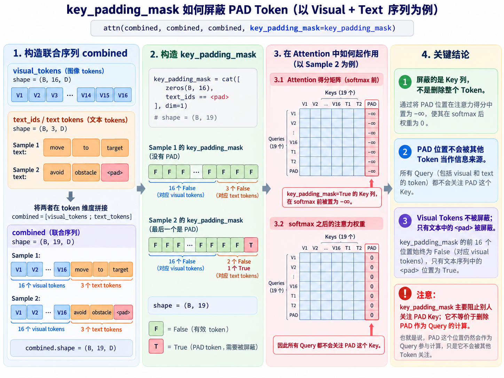
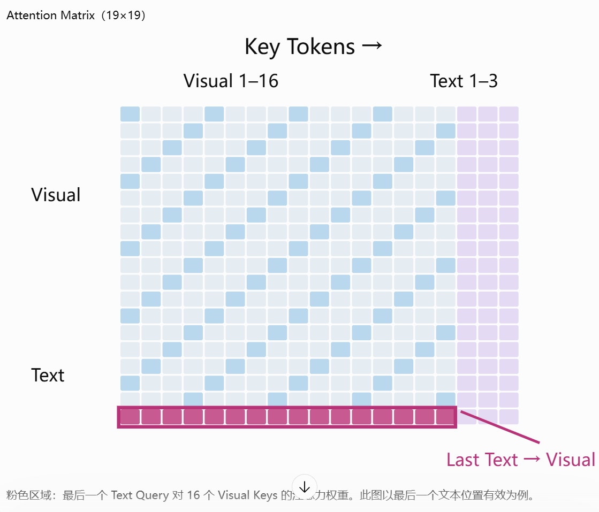
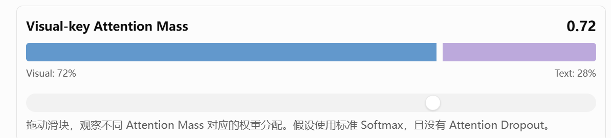

# 03-02 · Visual Token Projection — 学习笔记

[项目首页](../README.md) · [实验 Notebook](02_Visual_Token_Projection.ipynb) · [上一节笔记](01_ViT_From_Scratch.md) · [下一章](../04_Multimodal_Transformer/01_Multimodal_Tokenization.ipynb) · [知识库](../KNOWLEDGE_BASE.md#part-ii)

本节讨论 Visual Tokens 与 Text Tokens 的维度对齐、联合 Attention、Padding Mask、注意力分析与梯度传递。

---

## 1. 本节解决什么问题？

上一节 03-01 将图像转换为 Patch Tokens 并用 ViT Encoder 建模视觉关系。本节进一步研究：

1. 如何把视觉 Token 和文本 Token 放入**相同的隐藏特征维度**？
2. 如何把两种模态的 Token 拼为同一序列，利用 **Self-Attention** 交互？
3. 如何屏蔽文本补齐位置，防止 PAD 作为信息来源？
4. 如何观察 Text Query 对 Visual Keys 的关注？
5. 怎样证明文本输出中的目标可以对 Visual Projector 产生梯度？

本节使用随机初始化的视觉编码器、Embedding、Projector 和融合 Attention，验证跨模态计算接口；没有进行视觉语言语义训练。

## 2. 视觉与文本的 Token 表示

### 2.1 视觉侧：从图像到 Visual Tokens

本节采用简化的 RGB 图像 Vision Encoder：

- 图像大小： $32\times32$ ，RGB 三通道；
- Patch 边长： $P=8$ ；
- Patch 数量： $N_V=(32/8)^2=16$ ；
- 视觉编码维度： $D_V=64$ 。

图像经过 Patch Embedding、位置嵌入和一层 Transformer Encoder（Post-LN / ReLU）；此编码器独立初始化，没有加载上一节 TinyViT 的权重。 $B$ 表示批量大小。

$$
I\in\mathbb R^{B\times3\times32\times32}
\longrightarrow
Z_V\in\mathbb R^{B\times16\times64}.
$$

这里的 16 是**视觉 Token 数量**，64 是**每个视觉 Token 的特征维度**。视觉编码器可以输出一组 Patch 表征，不必通过 CLS Token 压缩成单一分类向量。

### 2.2 文本侧：Token ID 到 Text Embedding

文本 Tokenizer 的工作是将文字转换为离散的 Token IDs；对应的 Text Embedding 将每个 ID 转换为连续向量：

$$
T_{\mathrm{ids}}\in\lbrace0,1,2,3,4,5\rbrace^{B\times L_T}
\longrightarrow
Z_T\in\mathbb R^{B\times L_T\times D_{\mathrm{LLM}}}.
$$

本节没有调用真实 Tokenizer，而是手动指定 Token IDs。简化词表包含 `<pad>`、`move`、`to`、`target`、`avoid` 和 `obstacle`，以短指令作为示例：

- Sample 1：`move to target`；
- Sample 2：`avoid obstacle <pad>`。

因此 $B=2$ 、 $L_T=3$ ，而 $D_{\mathrm{LLM}}=96$ 。 $L_T$ 是包含 Padding 的文本长度；`D_LLM` 只是模拟接口宽度的变量名，本节没有接入 LLM。

真实 VLM / VLA 通常使用与语言模型**匹配的 Tokenizer 和 Embedding 参数**。将手动 Token IDs 替换为真实 Tokenizer 输出时，仍要确保 ID 到 Embedding 的映射、特殊 Token 与 Padding Mask 一致。

## 3. Visual Projector：维度对齐

视觉编码器与语言模型的隐藏维度可能不同：

$$
D_V=64,\qquad D_{\mathrm{LLM}}=96.
$$

本节采用线性 Visual Projector：

$$
\boxed{Z_V'=Z_VW_p^\top+b_p}
$$

其中：

$$
W_p\in\mathbb R^{96\times64},\qquad
b_p\in\mathbb R^{96}.
$$

同一个 Projector 应用于所有视觉 Token，偏置沿批量和序列维广播，Token 数量保持不变：

$$
Z_V'\in\mathbb R^{B\times16\times96},\qquad
Z_T\in\mathbb R^{B\times3\times96}.
$$

### 3.1 Dimension Alignment ≠ Semantic Alignment

**维度相同，只表示张量能够拼接或进入相同的 Attention 模块；不能证明语义已经对齐。**

原因是随机初始化的 $W_p$ 没有学习过哪种视觉特征与哪种语言概念对应。例如，“猫”的视觉特征投影到 96 维，不意味着该向量自动具有文本 `cat` 的语义。

语义对齐需要来自图文对应、视觉问答、动作预测等任务的**训练监督或可迁移的预训练参数**。其目标也不必是让两个模态的特征数值完全相等，而是让后续模型可以有效使用跨模态的语义关系。

本节证明的是：维度兼容、信息可以在 Attention 中交互、梯度可以回传。**并未证明语言与视觉已经完成语义对齐。**

## 4. 联合序列与跨模态 Self-Attention

将 Visual Tokens 和 Text Tokens 沿序列维拼接：

$$
X=[Z_V';Z_T]\in\mathbb R^{B\times19\times96}.
$$

融合阶段使用一层 Multi-Head Self-Attention，允许两种模态双向交互；这里没有添加 MLP、LayerNorm 或残差连接，因此不是完整的 Transformer Encoder Block，也不是因果语言解码器。文本位置编码同样未加入。

以下省略批量维与 Bias，采用行向量右乘的记法， $W_Q,W_K,W_V\in\mathbb R^{96\times96}$ 。实际 `nn.MultiheadAttention` 的输入投影和输出投影均包含 Bias：

$$
Q=XW_Q,\qquad K=XW_K,\qquad V=XW_V,
$$

$$
A_h=\mathrm{softmax}\left(\frac{Q_hK_h^\top}{\sqrt{d_h}}+M\right),
\qquad O_h=A_hV_h.
$$

完整 Q/K/V 沿特征维拆为 4 个 Head； $Q_h,K_h,V_h\in\mathbb R^{19\times d_h}$ ， $M$ 是加到分数矩阵上的 Mask。Softmax 沿 Key 维归一化。每个 Head 的特征维度为：

$$
d_h=\frac{96}{4}=24.
$$

每个 Head 的注意力权重矩阵为 $19\times19$ ；完整权重张量是：

$$
A\in\mathbb R^{B\times4\times19\times19}.
$$

联合 Self-Attention 中可以出现四类关联：

| Query | Key | 意义 |
|---|---|---|
| Visual | Visual | 图像区域之间交互 |
| Visual | Text | 视觉 Token 读取语言信息 |
| Text | Visual | 文本 Token 读取视觉信息 |
| Text | Text | 文本内部交互 |

这里是拼接序列上的联合 Self-Attention，Text → Visual 是其子块；它不同于单独以文本生成 Q、图像生成 K/V 的 Cross-Attention 模块。

## 5. Padding Mask：为什么屏蔽 Key 而保留 Query？

由于两条文本长度不同，Sample 2 最后一个位置是 `<pad>`。若不处理，其他 Query 可能会将这个无效位置当作信息来源。

Key Padding Mask：

$$
M_{\mathrm{key}}\in\lbrace\mathrm{False},\mathrm{True}\rbrace^{B\times19}.
$$

本节前 16 个视觉位置均为 False；3 个文本位置由是否等于 PAD 决定：

- Sample 1：19 个位置均为 False；
- Sample 2：前 18 个为 False，最后 1 个为 True。

布尔 Mask 沿 Head 和 Query 维广播。以下省略样本和 Head 下标， $i$ 为 Query 索引、 $j$ 为 Key 索引，均从 0 开始。Softmax 前，被屏蔽的 Key 列分数设为 $-\infty$ ：

$$
S_{ij}=
\begin{cases}
\mathbf q_i^\top\mathbf k_j/\sqrt{d_h}, & j\text{ 是有效 Key},\\
-\infty, & j\text{ 是 PAD Key}.
\end{cases}
$$

每行至少存在一个有效 Key 时，Softmax 后有：

$$
\boxed{A_{ij}=0\quad\text{当 }j\text{ 是 PAD Key}.}
$$

### Padding Mask 图解

图中 `(B, 3, D)` 对应 `text_tokens`；整数 `text_ids` 的形状是 `(B, 3)`。V1–V16 是图示编号，对应代码索引 0–15。

三个要点：

1. **屏蔽的是 PAD 所在的 Key 列**，不是删除整个 Token。
2. PAD Query 对应的行在常规计算中仍然存在，且可能从有效 Key 中聚合信息；保留它主要是为了维持规则的 Batch 张量结构。
3. 如果后续任务使用平均池化或汇总所有 Token，仍须避免将 PAD Query 的输出纳入有效结果。

Notebook 已通过断言验证：被标为 PAD 的 Key 所对应的注意力权重，在所有 Head 和所有 Query 上均为 0。当前 Batch 中只有一个 PAD Key，涉及 $4\times19=76$ 个被屏蔽的注意力权重。

## 6. 如何从注意力矩阵观察 Text → Visual

本节把第一个样本的最后一个**有效文本 Token**作为 Query。在文本右侧 Padding、视觉 Token 放在前面的条件下，若有 $N_V$ 个视觉 Token、有效文本长度为 $L_{\mathrm{valid}}$ ，该 Query 的序列索引为：

$$
i_{\mathrm{last}}=N_V+L_{\mathrm{valid}}-1.
$$

第一个样本： $N_V=16$ 、 $L_{\mathrm{valid}}=3$ ，因此索引为 18（从 0 开始）。

### 6.1 19×19 Attention Matrix

该图示意矩阵的分块与索引，不表示一次实际测量的权重值。图中的 Visual 1–16 对应代码索引 0–15：

- 行是 Query，列是 Key；
- 第 0–15 列是 Visual Keys；
- 第 16–18 列是 Text Keys；
- 最后一个有效 Text Query 的行与前 16 列相交的区域，表示 **Text → Visual Attention**。

对第 $h$ 个 Head：

$$
A^{(h)}_{\mathrm{text}\rightarrow\mathrm{visual}}
\in\mathbb R^{16}.
$$

因为视觉 Patch 在空间上是 $4\times4$ ，故这 16 个权重可以恢复为一张 $4\times4$ Attention 热力图。

### 6.2 为什么分别展示 4 个 Head？

**Attention 权重不是每个 Head 的输出特征。** 分别展示 4 个 Head，可以保留平均图会掩盖的权重差异；二者的区别见 [ViT Notes §5–7](01_ViT_From_Scratch.md)。

每个 Head 对应 $19\times19$ 权重矩阵，其 Text → Visual 部分是 $16$ 个数。不同 Head 可能具有不同的区域关注模式，也可能冗余。

四个 Heads 的真实前向计算是：

$$
O_h=A_hV_h,\qquad
O=\mathrm{Concat}(O_1,O_2,O_3,O_4)W_O.
$$

这里同样省略输出 Bias， $W_O\in\mathbb R^{96\times96}$ 。每个 $O_h$ 的形状为 $19\times24$ ，沿特征维拼接后为 $19\times96$ ：

$$
4\times24=96.
$$

**Head Mean 只能作为可视化汇总，模型合并的是各 Head 加权后的 Value 特征。**

Notebook 保留原始权重，每个 Head 使用独立 colorbar，按自身视觉权重的最小、最大值映射颜色。跨 Head 比较绝对值须读取各自刻度；相同颜色不表示相同权重。

## 7. Visual-key Attention Mass

### 7.1 定义

针对给定的 Text Query 与某个 Head，将其对所有 Visual Keys 的权重求和：

$$
\boxed{M_{\mathrm{visual}}^{(h)}
=\sum_{j=0}^{N_V-1}A_{ij}^{(h)}.}
$$

其中 $i=i_{\mathrm{last}}$ ，本节 $N_V=16$ 。当 Attention Dropout 为 0 且每行有有效 Key 时：

$$
M_{\mathrm{visual}}^{(h)}+
M_{\mathrm{text}}^{(h)}=1,
$$

其中对 PAD 的权重为 0，故有效文本 Keys 构成剩余部分。

### 7.2 静态比例示意图

上图中的 **0.72 / 0.28 是解释用的示例数值，不是当前模型跑出的测量结果**。

如果 $M_{\mathrm{visual}}=0.72$ ，只意味着该 Query 有 72% 的注意力权重落在视觉 Key 上，其余 28% 落在文本 Key 上，**不代表模型的视觉理解准确率为 72%**。

### 7.3 为什么必须与 Token 数量基线比较？

视觉 Tokens 比文本 Tokens 多。即使完全均匀分配注意力，视觉侧也会分到较高权重。

Sample 1 有 16 个视觉 Keys 和 3 个有效文本 Keys：

$$
M_{\mathrm{uniform}}=\frac{16}{16+3}
=\frac{16}{19}\approx0.8421.
$$

Sample 2 的 PAD Key 被屏蔽，仅剩 2 个有效文本 Keys：

$$
M_{\mathrm{uniform}}=\frac{16}{16+2}
=\frac{16}{18}\approx0.8889.
$$

在上述两种 Token 配置下，视觉权重为 0.72 都低于均匀分配基线。该基线用于区分 Token 数量与权重偏向的影响，并不是随机初始化网络的必然输出，也不表示最优分配。

[已保存的 GPU 输出 `9a85235`](https://github.com/Maple-Ze/Transformer-to-VLA/commit/9a85235) 中，第一个样本的四个 Head 的 Visual Mass 约为 `[0.8958, 0.9422, 0.8367, 0.8940]`；第三个 Head 略低于 `16/19`，其余高于该基线。这只是本次随机初始化和输入下的权重分配，不是语义理解的评估结果。

**Attention Mass 是权重之和，不是信息量占比或输出贡献比例。** Value 的大小、方向和输出投影都会影响结果，因果贡献仍需输入干预或消融实验。

## 8. 梯度从文本侧传回 Visual Projector

### 8.1 验证目标

虽然 Text Query 对 Visual Keys 赋予 Attention 权重，但这并不代表模型已经完成训练。本节还使用一个人为构造的标量探针来验证可微的路径。

取第一个样本的最后一个有效 Text Token 在 Attention 后的输出：

$$
\mathbf y_{\mathrm{text}}\in\mathbb R^{96}.
$$

使用 `linspace(-1, 1, 96)` 构造固定的、各分量不完全相同的测试向量：

$$
\mathbf p\in\mathbb R^{96},
$$

并定义：

$$
\boxed{\mathcal L_{\mathrm{probe}}
=\mathbf p^\top\mathbf y_{\mathrm{text}}.}
$$

这里的 $\mathcal L_{\mathrm{probe}}$ **不是训练分类或动作生成的任务 Loss**；只是为了方便检查计算图中的梯度连接。

### 8.2 为什么只选择一个 Text Token 也能产生视觉梯度？

Text Query 的 Self-Attention 输出可以依赖 Visual Keys 和 Values：

$$
\mathbf y_{\mathrm{text}}
=f(Z_V',Z_T;\theta_{\mathrm{attn}}).
$$

同时视觉投影满足：

$$
Z_V'=g(Z_V;W_p,b_p).
$$

对本实验被选中的第一个样本，记其视觉特征为 $\widetilde Z_V=Z_V[0]\in\mathbb R^{16\times64}$ ，投影特征为 $\widetilde Z'_V\in\mathbb R^{16\times96}$ 。由 Attention 反向传播得到：

$$
G=\frac{\partial\mathcal L_{\mathrm{probe}}}{\partial\widetilde Z'_V}
\in\mathbb R^{16\times96}.
$$

根据共享线性投影的链式法则：

$$
\frac{\partial\mathcal L_{\mathrm{probe}}}{\partial W_p}
=G^\top\widetilde Z_V\in\mathbb R^{96\times64}.
$$

$G$ 包含经过 Visual Keys 和 Values 的梯度；本实验的探针只使用第一个样本，且没有跨样本运算，所以第二个样本不贡献该 Loss 的梯度。

这说明即便损失只直接作用于一个 Text Token 的输出，也可以经由跨模态 Attention 向 Visual Projector 反向传播。

**不是每个任务都要求对每个 Token 单独计算 Loss。** 例如 ViT 分类可以只监督 CLS；语言建模常对多个预测 Token 计算 Loss；VLA 可对 Action Tokens 或动作轨迹施加训练目标。

### 8.3 梯度范数究竟包含什么？

当前 Visual Projector 的权重矩阵：

$$
W_p\in\mathbb R^{96\times64}.
$$

因此：

$$
\frac{\partial\mathcal L_{\mathrm{probe}}}{\partial W_p}
\in\mathbb R^{96\times64},
$$

共有：

$$
96\times64=\boxed{6144\text{ 个权重梯度}}.
$$

梯度的 L2/Frobenius 范数是：

$$
\boxed{
\left\lVert\nabla_{W_p}\mathcal L_{\mathrm{probe}}\right\rVert_F
=\sqrt{\sum_{a=0}^{95}\sum_{b=0}^{63}
\left(\frac{\partial\mathcal L_{\mathrm{probe}}}{\partial W_{p,ab}}\right)^2}.
}
$$

Bias 还有 96 个独立梯度，**不包括在上面这个 weight gradient norm 中**。

这里的 6144 个权重梯度综合了相关视觉 Tokens 对共享 Projector 权重的贡献，并不是 6144 个 Token，也不是整个模型的全部梯度。

Notebook 保存的权重形状与梯度形状均为 `[96, 64]`，梯度范数为 `9.463445`（四位小数显示为 `9.4634`）。

如果梯度范数大于 0，就表明该次实验中目标对视觉投影权重存在非零梯度依赖；**这不等价于已实现视觉语言语义对齐，也不意味着已经发生权重更新**。

## 9. 本节问题与结论速查

| 问题 | 结论 |
|---|---|
| 真实模型是否提供 Tokenizer？ | 通常使用语言模型匹配的 Tokenizer；还需确保 Embedding 与特殊 Token 设置一致 |
| 视觉 64 维为什么变 96 维？ | Projector 将 Visual Tokens 映射到与 Text Tokens 兼容的隐藏维度 |
| 随机 Projector 能否实现语义对齐？ | 不能；维度兼容不等于语义匹配 |
| Vision Encoder 与融合 Attention 有何区别？ | 前者编码视觉 Patch，包含完整 Encoder Layer；后者只对联合序列执行 Multi-Head Self-Attention |
| 为什么屏蔽 PAD Key？ | 防止其他 Query 从无效位置聚合信息 |
| 为什么 PAD Query 还存在？ | 通常为了维持统一张量长度；它的输出可在下游忽略 |
| Text → Visual 图展示什么？ | 指定 Text Query 对各 Visual Keys 的注意力权重 |
| 为什么不要只展示 Head Mean？ | 平均会掩盖不同 Heads 的差异；前向传播真正合并的是各 Head 的加权 Value 特征 |
| Visual Attention Mass 越大越好吗？ | 不一定；需要与视觉 Token 占比的均匀基线比较 |
| Probe Loss 是否真实训练损失？ | 不是；用于验证跨模态可微性 |
| 6144 个梯度来自哪里？ | 96×64 个 Projector 权重参数对 Probe Loss 的偏导数 |
| 梯度非零能否证明语义对齐？ | 不能；只验证参数依赖与反向传播路径 |

## 10. 与 VLA 的接口联系

本节完整的关键张量变化：

$$
\boxed{
\begin{aligned}
\text{RGB Image}:&\quad(B,3,32,32)\\
\downarrow\ \text{Vision Encoder}:&\quad(B,16,64)\\
\downarrow\ \text{Visual Projector}:&\quad(B,16,96)\\
\text{Text Embedding}:&\quad(B,3,96)\\
\downarrow\ \text{Concatenate}:&\quad(B,19,96)\\
\downarrow\ \text{Joint Self-Attention}:&\quad(B,19,96)
\end{aligned}
}
$$

并可以从联合 Attention 权重中读取：

$$
A\in\mathbb R^{B\times4\times19\times19}.
$$

在实际 VLA 中，视觉侧特征需要被语言模型或动作生成模型有效使用。**只做 Projector 维度对齐、联合 Attention 和梯度检验，是建立训练基础，而非建立具备语义理解的 VLA。**

连接预训练视觉语言表示、训练语义对齐目标及接入 Action Expert 属于后续 **Future Topics**。
